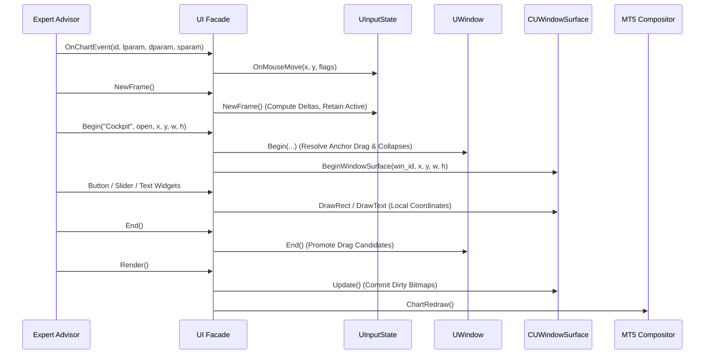

# DearMQL5 Technical Architecture Specification

This document provides a technical deep-dive into the internal subsystems of **DearMQL5**, including its immediate-mode execution pipeline, input state machine, retained state management, and the per-hub canvas rendering backend.

---

## 1. Subsystem Architecture

DearMQL5 is partitioned into decoupled layers with strict separation of concerns:

```
┌────────────────────────────────────────────────────────┐
│                   Public API Facade                    │
│                        (UI.mqh)                        │
└───────────┬────────────────────────────────┬───────────┘
            │                                │
            ▼                                ▼
┌───────────────────────┐        ┌───────────────────────┐
│   Window Containers   │        │     Widget Suite      │
│ (UWindow, ULayout)    │        │ (UButton, USlider...) │
└───────────┬───────────┘        └───────────┬───────────┘
            │                                │
            └────────────────┬───────────────┘
                             ▼
┌────────────────────────────────────────────────────────┐
│                  Core State & Layout                   │
│   - UInputState (Mouse, Keyboard, Dragging, Scroll)    │
│   - UState (Retained State Hash Map)                   │
│   - UIdStack (FNV-1a Hierarchical Hashing)             │
│   - UTheme (Color Palette & Styling)                   │
└────────────────────────────┬───────────────────────────┘
                             ▼
┌────────────────────────────────────────────────────────┐
│                   Rendering Backend                    │
│   - URendererCanvas (Isolated CUWindowSurface Pool)    │
│   - URendererNative (OBJ_RECTANGLE_LABEL Pool)         │
│   - UFont (Font Metrics & Text Width Cache)            │
└────────────────────────────────────────────────────────┘
```

---

## 2. The Frame Lifecycle Pipeline

Every execution cycle in an Expert Advisor or Indicator follows a three-stage pipeline:



### Stage 1: Input Aggregation (`NewFrame`)
1. Receives mouse position `(x, y)` and button flags from MT5's `CHARTEVENT_MOUSE_MOVE`.
2. Computes movement delta: `delta_x = mouse_x - prev_mouse_x` before updating previous coordinates.
3. Retains previous frame's `s_active_id` into `s_prev_active_id` so that release events (`s_mouse_released`) are properly recognized by widgets.
4. Resets `s_hot_id = 0` to prepare for the frame's hit-testing pass.

### Stage 2: Widget Evaluation & Layout (`Begin ... End`)
1. `UI::Begin`:
   - Retrieves persistent coordinates `(x, y, w, h)` from `UState` or `UWindowManager`.
   - Tests collapse button first to eliminate drag collision.
   - Evaluates window drag engine using absolute anchors.
   - Binds the active window surface in `URendererCanvas` and initializes `ULayout`.
2. Widgets evaluate their bounding boxes and hit-testing in `UWidget::Behavior`.
   - If mouse is within bounding box, registers widget as `Hot`.
   - If clicked, claims `Active` and keyboard focus.
   - If released while `Active` and `Hot`, returns `clicked = true`.
3. `UI::End`:
   - If the window was clicked and no child widget claimed active interaction, the window promotes candidate drag to active drag.
   - Restores layout and pops ID stack.

### Stage 3: Rendering & Compositing (`Render`)
1. Only surfaces marked with `is_dirty = true` execute `CCanvas::Update()`.
2. `UInputState::EndFrame()` cleans up any residual active captures.
3. `UDiagnostics` records frame duration and total draw calls.

---

## 3. Retained State Engine (`UState`)

Although DearMQL5's API is immediate-mode, state must persist between frames (e.g., whether a header is open, current slider value, or window positions).

- **64-bit FNV-1a Hash**: Each widget ID is hashed:
  $$\text{hash} = (\text{hash} \oplus \text{byte}) \times 1099511628211$$
- **Pre-Allocated Entry Array**: Stored in a contiguous array of `SUStateEntry` with geometric resizing ($64 \to 128 \to 256$), avoiding heap allocations after initial warm-up.
- **Frame Tracking**: Each entry logs `last_frame` for automatic garbage collection of dead widgets.

---

## 4. Per-Hub Canvas Architecture (`CUWindowSurface`)

Unlike traditional full-chart canvas models:
1. Each window owns a dedicated `CCanvas` instance mapped to a uniquely named chart bitmap: `DearMQL5_Hub_<win_id>_<chart_id>`.
2. **Local Coordinate Translation**: Widgets submit global coordinates `(gx, gy)`. `URendererCanvas` automatically translates:
   $$lx = gx - \text{surface.GetX()}$$
   $$ly = gy - \text{surface.GetY()}$$
3. **Zero-Cost Drag**:
   When a window moves from $(x_1, y_1)$ to $(x_2, y_2)$, the canvas pixels are untouched. DearMQL5 only calls:
   ```mql5
   ObjectSetInteger(chart_id, obj_name, OBJPROP_XDISTANCE, x2);
   ObjectSetInteger(chart_id, obj_name, OBJPROP_YDISTANCE, y2);
   ```
   MT5's internal DirectX compositor shifts the bitmap directly on the screen at zero CPU rasterization cost.

---

## 5. Chart Scroll Suppression & Interaction Guard

When dragging standard graphical objects on MetaTrader charts, MT5's default handler attempts to scroll price history horizontally.

DearMQL5 mitigates this using automatic scroll locking:
```mql5
// On Drag Start:
ChartSetInteger(chart_id, CHART_MOUSE_SCROLL, false);

// On Drag Release:
ChartSetInteger(chart_id, CHART_MOUSE_SCROLL, true);
```

This guarantees smooth HUD movement without disrupting chart viewports.
